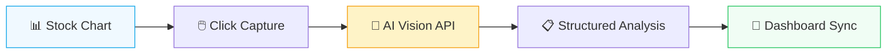

<p align="center">
  
</p>

<h1 align="center">🔮 LiquiSight</h1>
<h3 align="center">AI-Powered Visual Finance Copilot</h3>

<p align="center">
  <strong>Transform any stock chart into actionable insights with the power of AI vision</strong>
</p>

<p align="center">
  
  
  
  
  
</p>

<p align="center">
  <a href="#-the-problem">Problem</a> •
  <a href="#-our-solution">Solution</a> •
  <a href="#-key-features">Features</a> •
  <a href="#-demo">Demo</a> •
  <a href="#-architecture">Architecture</a> •
  <a href="#-quick-start">Quick Start</a> •
  <a href="#-team">Team</a>
</p>

---

## 🎯 The Problem

**Retail investors are flying blind.**

Every day, millions of retail investors make decisions based on stock charts they don't fully understand. They see patterns but lack the expertise to interpret them. They browse financial websites, screenshot charts, and try to make sense of complex technical indicators.

| Pain Point | Impact |
|------------|--------|
| 📊 **Chart Complexity** | 73% of retail investors struggle to read technical charts |
| ⏰ **Information Overload** | Average investor spends 2+ hours daily researching |
| 🎲 **Emotional Decisions** | 80% of trading decisions are influenced by cognitive bias |
| 💰 **Costly Mistakes** | Retail investors lose avg. $1,500/year on preventable errors |

---

## 💡 Our Solution

**LiquiSight** is an AI-powered visual finance copilot that instantly analyzes any stock chart and provides clear, unbiased insights.

<table>
<tr>
<td width="50%">

### 🖱️ One-Click Analysis
Point at any chart. Click analyze. Get instant AI insights.

### 🧠 Multi-Model AI
Powered by GPT-4o Vision, Gemini, and OpenRouter for maximum accuracy.

### 🎨 Beautiful Dashboard  
Track all your scans, manage portfolios, and visualize trends.

</td>
<td width="50%">

### 🔒 No Financial Advice
Purely factual observations - trend, risk level, and confidence scores.

### ⚡ Real-Time Processing
Analysis in under 3 seconds, directly in your browser.

### 📱 Works Everywhere
Chrome extension + web dashboard for seamless experience.

</td>
</tr>
</table>

---

## ✨ Key Features

### 🔍 Smart Chart Scanner
```
📸 Capture any chart from any website with one click
🤖 AI analyzes trend direction, risk level, and patterns
📊 Get confidence scores and plain-English explanations
🚫 No investment advice - just facts and observations
```

### 📈 Interactive Dashboard
```
📉 Real-time market overview (S&P 500, NASDAQ, DOW, VIX)
🔎 Discover stocks with AI-powered sparkline charts
📋 Watchlist with trend indicators and risk scores
🕐 Complete scan history with search and filters
```

### 💼 Portfolio Intelligence
```
💰 Track holdings with AI risk signals
📊 Performance vs benchmark visualization
🎯 Goal tracking with progress indicators
🔄 Recent transactions with allocation breakdown
```

### 🧩 Chrome Extension
```
Alt+L  → Toggle LiquiSight panel on any page
📷    → Capture visible chart area
🔮    → Instant AI analysis in sidebar
💾    → Auto-sync with dashboard
```

---

## 🎬 Demo

### How It Works



### Analysis Response

```json
{
  "stock_name": "AAPL",
  "trend": "Uptrend",
  "risk": "Medium",
  "confidence": 0.87,
  "explanation": "The chart displays a series of higher highs and higher 
    lows over the past 3 months. RSI remains above 50 indicating bullish 
    momentum. Notable support level visible around $180. Volume confirms 
    the upward price movement."
}
```

---

## 🏗️ Architecture

```
┌─────────────────────────────────────────────────────────────────┐
│                        LiquiSight Stack                          │
├─────────────────────────────────────────────────────────────────┤
│                                                                   │
│  ┌──────────────┐    ┌──────────────┐    ┌──────────────┐       │
│  │   Chrome     │    │    Next.js   │    │   FastAPI    │       │
│  │  Extension   │───▶│   Dashboard  │◀───│   Backend    │       │
│  │  (Manifest   │    │  (React 19)  │    │  (Python)    │       │
│  │    V3)       │    │              │    │              │       │
│  └──────────────┘    └──────────────┘    └──────────────┘       │
│         │                   │                   │                │
│         │                   │                   │                │
│         ▼                   ▼                   ▼                │
│  ┌──────────────────────────────────────────────────────┐       │
│  │                    AI Vision Layer                     │       │
│  │  ┌─────────┐  ┌─────────┐  ┌─────────┐  ┌─────────┐  │       │
│  │  │ OpenAI  │  │OpenRouter│  │ Gemini  │  │  Demo   │  │       │
│  │  │ GPT-4o  │  │  (Any)   │  │  2.0    │  │  Mode   │  │       │
│  │  └─────────┘  └─────────┘  └─────────┘  └─────────┘  │       │
│  └──────────────────────────────────────────────────────┘       │
│                                                                   │
│  ┌──────────────────────────────────────────────────────┐       │
│  │                   Data Layer                           │       │
│  │           Supabase (PostgreSQL + Auth)                 │       │
│  └──────────────────────────────────────────────────────┘       │
│                                                                   │
└─────────────────────────────────────────────────────────────────┘
```

### Tech Stack

| Layer | Technology | Purpose |
|-------|-----------|---------|
| **Frontend** | Next.js 16, React 19, TypeScript | Dashboard & Portfolio UI |
| **Styling** | Tailwind CSS, Radix UI, Recharts | Beautiful, accessible components |
| **Extension** | Chrome Manifest V3 | Browser integration |
| **Backend** | FastAPI, Python 3.11 | API & AI orchestration |
| **AI** | GPT-4o Vision, Gemini 2.0, OpenRouter | Multi-model chart analysis |
| **Database** | Supabase (PostgreSQL) | Scan history & user data |

---

## 🚀 Quick Start

### Prerequisites

- Node.js 18+ & npm/pnpm
- Python 3.10+
- Chrome browser
- API keys (OpenAI, Gemini, or OpenRouter)

### 1. Clone & Install

```bash
git clone https://github.com/your-team/liquisight.git
cd liquisight
```

### 2. Backend Setup

```bash
cd backend
python -m venv venv
.\venv\Scripts\activate  # Windows
pip install -r requirements.txt

# Create .env with your API keys
echo "OPENAI_API_KEY=sk-..." > .env
echo "GEMINI_API_KEY=AIza..." >> .env

# Start the API server
uvicorn main:app --port 8000 --reload
```

### 3. Web Dashboard

```bash
cd web
npm install
npm run dev
# Open http://localhost:3000
```

### 4. Chrome Extension

```bash
# In Chrome:
# 1. Go to chrome://extensions
# 2. Enable "Developer mode"
# 3. Click "Load unpacked"
# 4. Select the /extension folder
# 5. Press Alt+L on any page to activate!
```

---

## 📁 Project Structure

```
LiquiSight/
├── 🌐 web/                    # Next.js Dashboard
│   ├── app/                   # App router pages
│   ├── components/            # React components
│   │   ├── dashboard.tsx      # Main dashboard
│   │   ├── portfolio.tsx      # Portfolio view
│   │   ├── scan-history.tsx   # Scan history
│   │   └── ui/                # Reusable UI components
│   ├── context/               # React contexts
│   └── lib/                   # Utilities & API
│
├── 🤖 backend/                # FastAPI Backend
│   ├── main.py                # API endpoints
│   ├── chart_analyzer.py      # AI analysis logic
│   └── contract.md            # API contract spec
│
├── 🧩 extension/              # Chrome Extension
│   ├── manifest.json          # Extension config
│   ├── popup/                 # Extension popup UI
│   ├── sidepanel/             # Side panel UI
│   ├── content/               # Content scripts
│   └── background/            # Service worker
│
└── 📊 ppt/                    # Pitch materials
```

---

## 🔐 API Contract

All components communicate via a locked API contract:

```typescript
interface AnalysisResponse {
  stock_name: string;                        // e.g., "AAPL"
  trend: "Uptrend" | "Downtrend" | "Sideways";
  risk: "Low" | "Medium" | "High";
  confidence: number;                        // 0.0 to 1.0
  explanation: string;                       // Plain English
}
```

**Design Principles:**
- ✅ Factual observations only
- ✅ Confidence scores for uncertainty
- ❌ No buy/sell recommendations
- ❌ No price predictions

---

## 🎨 Screenshots

<table>
<tr>
<td width="50%">
<h4>📊 Dashboard</h4>
<p>Market overview with live indices, AI-powered discover cards, and watchlist</p>
</td>
<td width="50%">
<h4>💼 Portfolio</h4>
<p>Holdings with AI risk signals, performance charts, and allocation breakdown</p>
</td>
</tr>
<tr>
<td width="50%">
<h4>🔍 Scan History</h4>
<p>Complete analysis history with search, filters, and confidence scores</p>
</td>
<td width="50%">
<h4>🧩 Extension</h4>
<p>One-click chart capture with instant AI analysis in sidebar</p>
</td>
</tr>
</table>

---

## 🏆 Why LiquiSight Wins

| Criteria | Our Approach |
|----------|--------------|
| **Innovation** | First multi-modal AI chart analyzer with browser integration |
| **Technical Depth** | Full-stack: Extension + Dashboard + AI Backend |
| **User Experience** | One-click analysis, beautiful UI, instant results |
| **Scalability** | Multi-provider AI fallback, Supabase for data |
| **Responsibility** | No financial advice - purely educational insights |
| **Completeness** | Production-ready with real AI integration |

---

## 🛣️ Roadmap

- [x] **v1.0** - Core MVP (Chrome Extension + Dashboard + AI)
- [ ] **v1.1** - Firefox & Safari extension support
- [ ] **v1.2** - Mobile app (React Native)
- [ ] **v2.0** - Social features (share scans, community insights)
- [ ] **v2.1** - Custom AI fine-tuning for specific chart patterns
- [ ] **v3.0** - Real-time alerts & watchlist notifications

---

## 👥 Team

<table>
<tr>
<td align="center">
<strong>Team LiquiSight</strong><br/>
<em>Building the future of retail investing</em>
</td>
</tr>
</table>

---

## 📄 License

MIT License - See [LICENSE](LICENSE) for details.

---

<p align="center">
  <strong>Built with ❤️ at Hackathon 2026</strong>
</p>

<p align="center">
  
</p>
